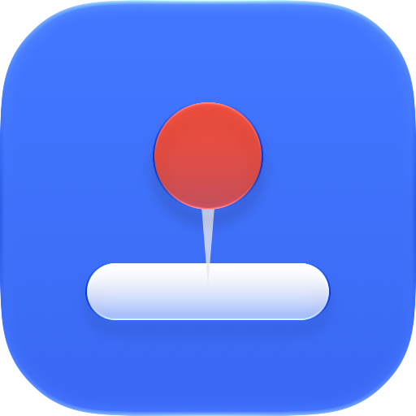

#  dockpin

[English](README.md) · **한국어**

**macOS Dock 을 한 화면에 고정합니다.**

모니터를 여러 대 쓰면, 어느 화면이든 아래쪽 가장자리에 마우스를 밀어붙이는 순간
Dock 이 그 화면으로 옮겨갑니다. 두 번째 모니터 아래쪽 창을 잡으려다 Dock 이 따라오는
일이 반복되는데, 이걸 끄는 설정은 없습니다.

dockpin 은 이걸 막는 작은 메뉴바 앱입니다. Dock 이 있어야 할 화면을 고르면, 나머지
화면의 Dock 쪽 가장자리는 더 이상 Dock 을 부르지 않습니다. 일부러 옮기고 싶을 땐
`Option` 을 누른 채로 밀면 됩니다.

## 설치

```sh
brew install --cask esteban-eg-kim/tap/dockpin
```

또는 [Releases](https://github.com/esteban-eg-kim/dockpin/releases) 에서
`dockpin-x.y.z.zip` 을 받아 `dockpin.app` 을 `/Applications` 로 옮긴 뒤 한 번 실행:

```sh
xattr -dr com.apple.quarantine /Applications/dockpin.app
```

유료 Apple 개발자 계정이 없어 공증(notarization)을 받지 않았기 때문에, 이 명령이
없으면 macOS 가 앱을 열지 않습니다. 소스는 전부 공개되어 있으니
[직접 빌드](#빌드)해도 됩니다.

macOS 13 이상.

## 사용법

1. dockpin 을 열면 **손쉬운 사용** 권한을 요청합니다: 시스템 설정 › 개인정보 보호 및
   보안 › 손쉬운 사용 › dockpin 켜기. 마우스 이동을 걸러내고, 화면을 고를 때 커서를
   움직이는 데 씁니다. 키보드는 보지 않으므로 입력 모니터링 권한은 필요 없습니다.
2. 메뉴바의 핀 아이콘 › **Keep the Dock on** 에서 화면을 고릅니다.
   처음 실행 시엔 지금 Dock 이 있는 화면으로 자동 설정됩니다.

| 메뉴 | 동작 |
|---|---|
| Pin the Dock | dockpin 켜기/끄기. 꺼져 있으면 핀 아이콘에 사선이 그어집니다. |
| Keep the Dock on | Dock 을 고정할 화면. 고르면 Dock 이 바로 그 화면으로 옮겨갑니다. |
| Hold ⌥ to Let It Move | `Option` 을 누르고 있는 동안은 원래대로 Dock 이 옮겨갑니다. |
| Open at Login | 로그인 시 자동 실행. |

## 동작 원리

Dock 은 커서가 화면의 Dock 쪽 가장자리를 미는 것을 보고 옮겨갑니다. dockpin 은
마우스 이벤트 탭을 걸어, 고정 화면이 아닌 화면의 그 가장자리 4pt 띠 안에서 생긴
마우스 이동 이벤트를 버립니다. 커서 자체는 그대로 움직이고, Dock 만 그 "밀기"를
못 봅니다.

화면을 고르면 dockpin 이 사람이 하듯 Dock 을 옮깁니다: 커서를 숨기고 그 화면의 Dock
쪽 가장자리로 0.5초쯤 밀었다가 원래 자리로 돌려놓습니다. 너머에 다른 화면이 없는
구간에서 밀기 때문에 커서가 옆 화면으로 넘어가지 않습니다. 고정한 화면을 다시
연결했을 때도 같은 방식으로 Dock 을 데려옵니다.

가장자리 중 **바깥쪽** 부분만 막습니다. 아래(왼쪽/오른쪽 Dock 이면 옆)에 다른
화면이 붙어 있는 구간은 평소처럼 넘어갈 수 있습니다. Dock 위치(아래/왼쪽/오른쪽)
변경과 모니터 연결/해제는 자동으로 반영됩니다.

## 한계

- 다른 화면의 그 4pt 띠 안에서는 앱이 마우스 hover 이벤트를 받지 못합니다.
- 다른 화면의 Dock 쪽 핫코너는 동작하지 않습니다.
- macOS 는 이 권한들을 앱 서명에 묶습니다. dockpin 은 ad-hoc 서명이라 업그레이드 후
  손쉬운 사용 목록에서 dockpin 을 지웠다가(`−`) 다시 추가해야 할 수 있습니다.
- 고정한 화면을 뽑으면, 다시 연결될 때까지 Dock 을 지금 있는 화면에 붙잡아 두고, 연결되면 다시 데려옵니다.
- Dock 자동 가리기를 켜 두면 Dock 이 어느 화면에 있는지 알 수 없어서, 화면을 직접 고를 때만 옮깁니다.

## 빌드

Xcode Command Line Tools 만 있으면 됩니다 (`xcode-select --install`).

```sh
scripts/test.sh               # 기하 계산 테스트 (CLT 환경용 swift test)
ARCHS=arm64 scripts/bundle.sh # → build/dockpin.app
open build/dockpin.app
```

ad-hoc 빌드는 매번 서명이 바뀌어 손쉬운 사용 권한이 초기화됩니다. 유지하려면 자체
서명 코드 서명 인증서 하나로 모든 빌드를 서명하세요:
`SIGN_ID="<이름 또는 SHA-1>" scripts/bundle.sh`. `codesign` 이 `errSecInternalComponent`
로 실패하면(키 접근 확인 창을 못 띄움), 인증서를 전용 키체인에 넣고
`SIGN_KEYCHAIN=<경로>`, `SIGN_KEYCHAIN_PASSWORD=<비밀번호>` 를 함께 주세요.
`.env.signing`(git 제외)에 적어 두면 기본값이 됩니다.

## 관련 프로젝트

[DockAnchor](https://github.com/bwya77/DockAnchor) 도 같은 문제를 풀며 기능이 더
많습니다(프로필, Dock 자동 복귀). dockpin 은 더 작게: 메뉴 하나, 화면 사이
맞닿은 가장자리는 열어 둡니다.

## 라이선스

MIT
