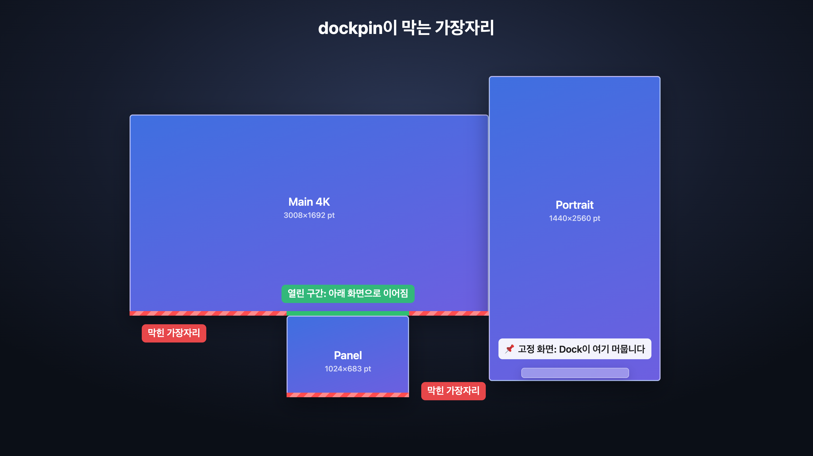

#  dockpin

[English](README.md) · **한국어** · [웹사이트](https://xkorfun.github.io)

**macOS Dock을 한 화면에 고정합니다.**

모니터를 여러 대 쓰면, 어느 화면이든 아래쪽 가장자리에 커서를 밀어붙이는 순간 Dock이
그 화면으로 옮겨갑니다. 두 번째 모니터 아래쪽 창을 잡으려다 Dock이 따라오는 일이
반복되는데, 이걸 끄는 설정은 없습니다.

dockpin은 이걸 막는 작은 메뉴바 앱입니다.

<p align="center">
  
</p>

<p align="center"><a href="docs/media/demo-ko.mp4">원본 화질로 보기 (MP4)</a></p>

## 기능

- **Dock이 제자리에 있습니다.** 다른 화면의 Dock 쪽 가장자리가 더 이상 Dock을 끌어가지
  않습니다. 커서는 그대로 자유롭게 움직입니다.
- **화면을 고르면 Dock이 그리로 갑니다.** 메뉴바에서 바로.
- **`Option` 을 누른 채로** 밀면 원할 때 평소처럼 옮길 수 있습니다.
- **화면 배치를 압니다.** 다른 화면과 맞닿은 가장자리는 열어 두어 위아래로 쌓은
  모니터 사이를 커서가 그대로 넘어갑니다. 아래/왼쪽/오른쪽 Dock 모두 지원.
- **macOS가 직접 옮겨도**(모니터가 절전에서 깨어날 때) 고정 화면을 다시 연결해도
  Dock을 데려옵니다. 잠금 화면에서는 절대 움직이지 않습니다.
- **대체 화면**: 고정 화면이 빠져 있는 동안 Dock을 둘 화면을 정할 수 있습니다.
- **자동 가리기에서도 동작합니다.**
- **권한 하나, 네트워크 없음.** 손쉬운 사용 권한만 씁니다. 키보드 접근 없음, 수집 없음.

## 설치

```sh
brew install --cask esteban-eg-kim/tap/dockpin
```

또는 [Releases](https://github.com/esteban-eg-kim/dockpin/releases) 에서
`dockpin-x.y.z.zip` 을 받아 `dockpin.app` 을 `/Applications` 로 옮긴 뒤 한 번 실행:

```sh
xattr -dr com.apple.quarantine /Applications/dockpin.app
```

dockpin은 서명은 되어 있지만 공증(notarization)은 받지 않았습니다(유료 Apple 개발자
계정 필요). 그래서 이 명령이 없으면 macOS가 앱을 열지 않습니다. Homebrew로 설치하면
알아서 처리됩니다.

## 빠른 시작

1. dockpin을 열고 시스템 설정 › 개인정보 보호 및 보안 › **손쉬운 사용** 에서 허용합니다
   (macOS 27: **Device Control and Data Access**).
2. 메뉴바의 핀 아이콘 › **Keep the Dock on** 에서 화면을 고릅니다.
3. 끝. 다른 화면 아래쪽으로 커서를 밀어도 Dock이 그대로 있습니다.

<p align="center"></p>

메뉴 항목 전부, 여러 화면 배치, 자동 가리기, 문제 해결은 **[사용 설명서](docs/manual.ko.md)**
([English](docs/manual.md)) 에 있습니다.

## 동작 원리

Dock은 커서가 화면의 Dock 쪽 가장자리를 미는 것을 보고 옮겨갑니다. dockpin은 고정
화면이 아닌 모든 화면의 그 가장자리 4pt 띠 안에서 생긴 마우스 움직임을 버립니다.
그것도 가장자리의 *바깥쪽* 부분에서만.

<p align="center"></p>

Dock을 옮길 때는 사람이 하듯이, 고정 화면의 Dock 쪽 가장자리로 커서를 0.5초쯤
밀었다가 원래 자리로 돌려놓습니다.

## 요구 사항

| | |
|---|---|
| macOS | 13 Ventura 이상 (macOS 27에서 테스트) |
| 칩 | Apple 실리콘과 Intel (유니버설) |
| 권한 | 손쉬운 사용 |

## 빌드

Xcode Command Line Tools 만 있으면 됩니다 (`xcode-select --install`).

```sh
scripts/test.sh               # 단위 테스트
ARCHS=arm64 scripts/bundle.sh # → build/dockpin.app
open build/dockpin.app
```

다시 빌드해도 권한을 유지하는 법은 [소스에서 빌드](docs/manual.ko.md#소스에서-빌드),
그림과 영상을 다시 만드는 법은 `docs/media/make.sh` 를 보세요.

## 관련 프로젝트

[DockAnchor](https://github.com/bwya77/DockAnchor) 도 같은 문제를 풀며 기능이 더
많습니다(프로필, Dock 자동 복귀). dockpin은 더 작게: 메뉴 하나, 화면 사이 맞닿은
가장자리는 열어 둡니다.

## 라이선스

MIT
