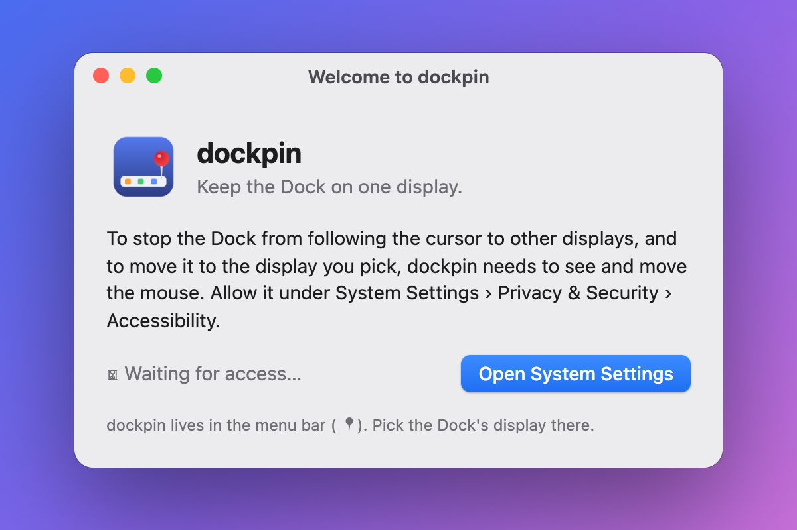
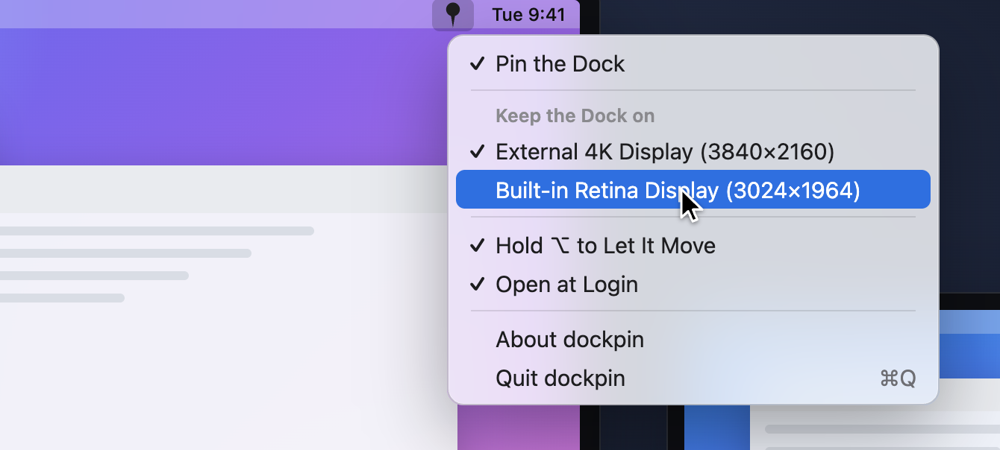
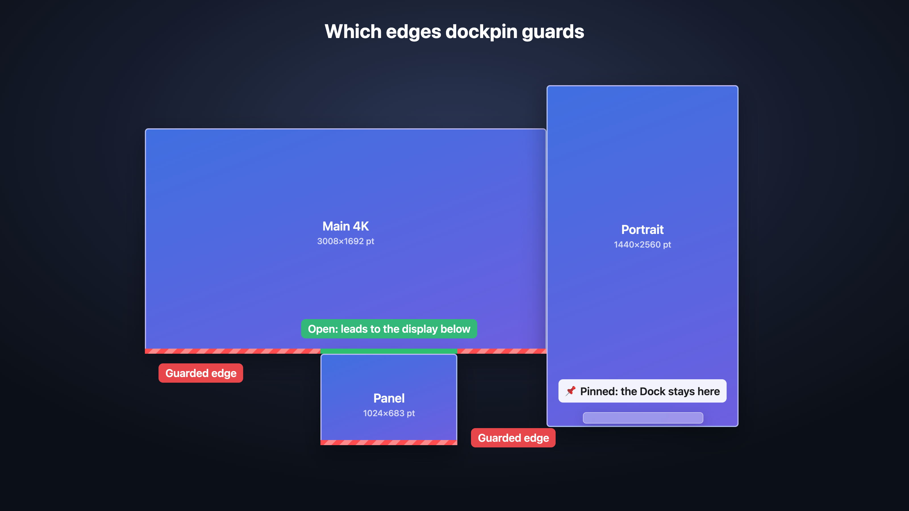

# dockpin manual

**English** · [한국어](manual.ko.md)

dockpin keeps the macOS Dock on the display you choose. This manual covers
installing it, the menu, how it decides which edges to guard, and what to do when
something looks off.

- [Install](#install)
- [First launch: the one permission](#first-launch-the-one-permission)
- [The menu](#the-menu)
- [Moving the Dock](#moving-the-dock)
- [Which edges are guarded](#which-edges-are-guarded)
- [Everyday situations](#everyday-situations)
- [Troubleshooting](#troubleshooting)
- [Privacy](#privacy)
- [Update and uninstall](#update-and-uninstall)
- [Supported macOS versions](#supported-macos-versions)
- [Build from source](#build-from-source)


[Watch the demo as MP4](media/demo-en.mp4)

## Install

**Homebrew** (recommended):

```sh
brew install --cask esteban-eg-kim/tap/dockpin
```

**By hand:** download `dockpin-x.y.z.zip` from
[Releases](https://github.com/esteban-eg-kim/dockpin/releases), unzip it, move
`dockpin.app` to `/Applications`, then run once in Terminal:

```sh
xattr -dr com.apple.quarantine /Applications/dockpin.app
```

dockpin is signed with its own certificate but not notarized by Apple (that needs
a paid developer account). Without the line above, macOS says the app "can't be
opened". Homebrew does this step for you.

## First launch: the one permission

Open dockpin. A pin appears in the menu bar and a welcome window asks for one
permission.



1. Click **Open System Settings**.
2. Turn on **dockpin** in the list:
   - macOS 13–26: **Privacy & Security › Accessibility**
   - macOS 27: **Privacy & Security › Device Control and Data Access**
3. Come back. Within a second the window says **Access allowed**. Click **Done**.

That is the only permission dockpin needs. It does **not** need Input Monitoring;
that permission is for reading the keyboard, which dockpin never does.

On first launch dockpin pins the Dock to the display it is on right now.

## The menu

Click the pin in the menu bar.



| Item | What it does |
|---|---|
| **Pin the Dock** | Turns dockpin on or off. Off, the menu bar icon shows a crossed-out pin and the Dock behaves as macOS normally does. |
| **Keep the Dock on** | Lists your displays by name and resolution. The checked one is where the Dock lives. Picking another moves the Dock there at once. |
| **Hold ⌥ to Let It Move** | While on, holding `Option` lets the Dock move the usual way. |
| **Open at Login** | Starts dockpin when you log in. |
| **⚠️ Allow Accessibility Access…** | Shown only while the permission is missing. Opens the right page in System Settings. |
| **About dockpin** / **Quit dockpin** | Version info / quit (`⌘Q`). |

The menu bar icon tells you the state at a glance: a solid pin means dockpin is
guarding; a crossed-out pin means it is off or still waiting for permission.

## Moving the Dock

There are two ways to put the Dock on another display.

**Pick it in the menu.** Choose the display under **Keep the Dock on**. For about
half a second the pointer disappears; dockpin runs it into that display's Dock
edge, the Dock follows, and the pointer comes back to where it was. Don't move the
mouse in that half second; dockpin ignores it anyway.

**Hold ⌥ and push.** With **Hold ⌥ to Let It Move** on, hold `Option` and push the
pointer against the bottom of another display. The Dock moves the way it always
did. This does not change the pinned display: it is a one-off.

dockpin also brings the Dock home on its own when:

- you turn **Pin the Dock** back on,
- dockpin starts (or just got the permission), and
- the pinned display is plugged back in.

It does not pull the Dock back after an `Option` move. You moved it on purpose.

## Which edges are guarded

The Dock moves when the pointer presses against a display's Dock edge. dockpin
watches mouse movement and drops the moves that land in a thin strip (4 points)
along that edge, on every display except the pinned one. The pointer still moves
normally; the Dock just never sees the push.

Only the **outer** parts of an edge are guarded. Where another display is attached
beyond the edge, the pointer crosses over as usual:



Here the Dock is pinned to the portrait display. The bottom of the main display is
guarded except the stretch above the small panel, which stays open so you can move
the pointer down into it. The panel's own bottom is guarded.

If your Dock is on the left or right side (System Settings › Desktop & Dock ›
Position on screen), dockpin guards the left or right edges instead. It notices the
change by itself within a few seconds.

## Everyday situations

**Unplugging the pinned display.** While it is gone, dockpin keeps the Dock where
it is now instead of letting it wander. Plug the display back in and the Dock
returns to it.

**Dock auto-hide.** With "Automatically hide and show the Dock" on, macOS gives no
way to tell which display the Dock is on. Guarding works the same, but dockpin only
moves the Dock when you pick a display in the menu.

**Hot corners.** Hot corners at the Dock edge of the *other* displays don't fire,
because those moves are dropped. Hot corners on the pinned display and on the other
edges work as usual.

**Hovering at the very bottom.** Apps on the other displays don't get hover events
in the 4-point strip at their Dock edge. Clicks still go through.

## Troubleshooting

**The pin is crossed out, or the menu shows "⚠️ Allow Accessibility Access…".**
The permission is missing. Open System Settings from the menu item and turn
dockpin on. If it already looks on, see the next item.

**dockpin is switched on in System Settings, but it still waits for access.**
The entry belongs to an older copy of the app. In the list, select **dockpin**,
click **−** to remove it, then use **Open System Settings** in dockpin (or **+**)
to add it again and switch it on.

**The Dock still moves to another display.**
- Check that the pin icon is solid and **Pin the Dock** is checked.
- Check that you weren't holding `Option`.
- Make sure the checked display under **Keep the Dock on** is the one you want.

**Picking a display didn't move the Dock.**
- If Dock auto-hide is on, show the Dock once on the target display, or pick
  the display again.
- If the pinned display's whole Dock edge touches another display, there is no
  outer stretch to push against; dockpin can't move the Dock there. Move the
  Dock with `Option`, or rearrange displays in System Settings › Displays.

**"dockpin can't be opened because Apple cannot check it for malicious software."**
Run `xattr -dr com.apple.quarantine /Applications/dockpin.app` once, or install
with Homebrew.

## Privacy

dockpin has no network code, collects nothing and stores only its own settings
(which display is pinned and the menu toggles) in
`~/Library/Preferences/io.github.esteban-eg-kim.dockpin.plist`. It sees mouse
movement and nothing else. The source is in this repository.

## Update and uninstall

```sh
brew upgrade --cask dockpin              # update
brew uninstall --cask --zap dockpin      # remove the app and its settings
```

By hand: quit dockpin, delete `/Applications/dockpin.app`, and remove dockpin from
the Accessibility (or Device Control and Data Access) list.

## Supported macOS versions

| | |
|---|---|
| Minimum | macOS 13 Ventura |
| Tested | macOS 27 on Apple silicon |
| Chips | Apple silicon and Intel (one universal app) |

macOS 13 is the floor because the menu bar menu and Open at Login rely on APIs
added in 13. Versions 13–26 and Intel Macs are expected to work but haven't been
tested by the author yet; reports are welcome in
[Issues](https://github.com/esteban-eg-kim/dockpin/issues).

## Build from source

Only the Xcode Command Line Tools are needed (`xcode-select --install`).

```sh
git clone https://github.com/esteban-eg-kim/dockpin
cd dockpin
scripts/test.sh                 # unit tests for the edge geometry
ARCHS=arm64 scripts/bundle.sh   # → build/dockpin.app
open build/dockpin.app
```

Each ad-hoc build gets a new signature, and macOS ties the permission to the
signature, so it asks again after every rebuild. To avoid that, sign with one
self-signed code signing certificate: `SIGN_ID="<name or SHA-1>"
scripts/bundle.sh`. See the comments at the top of `scripts/bundle.sh` for using a
dedicated keychain, and `docs/media/make.sh` to regenerate the pictures and the
demo video.
